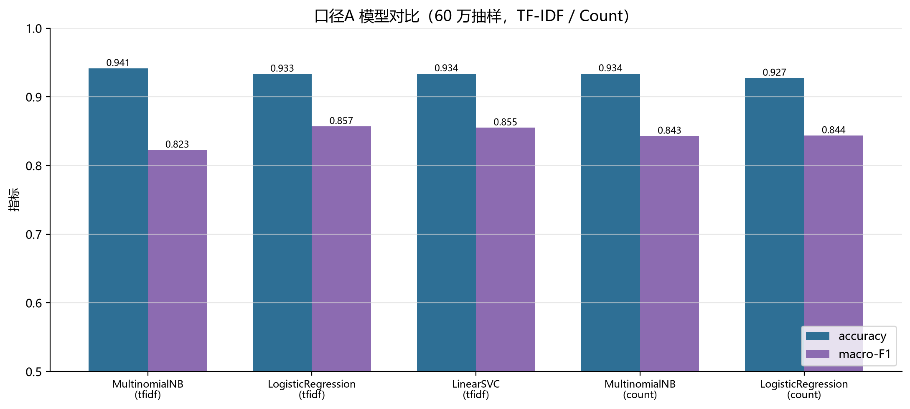
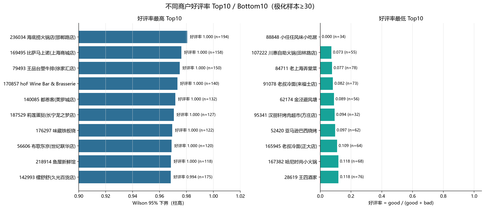
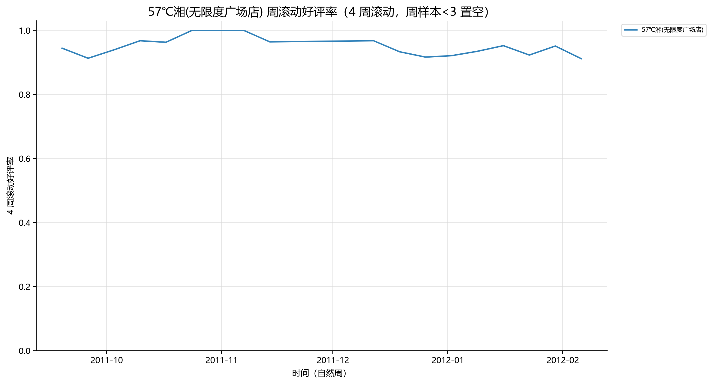

# 综合实验 1 · 文本分析

基于大众点评商户评论数据的中文文本分析实验：数据清洗与标签构造、jieba 分词、TF-IDF / Count 特征、好评/差评二分类、词云与高频词、商户维度统计可视化，以及关键词查询与单店分析。

- 数据规模：4,107,199 条评论，241,360 家商户，时间跨度 2003-04 ~ 2012-02
- 任务覆盖：实验要求的 11 项任务全部实现，对应 5 个 notebook 与 `src/` 模块
- 关键结果：口径 A（好评 1 / 差评 0）下 **accuracy 0.9403、macro-F1 0.868**（60 万抽样）；全量 194 万极化样本 **accuracy 0.9395、macro-F1 0.8699**

## 主要结果

| 实验 | 特征 | 模型 | accuracy | macro-F1 | 差评 recall |
|---|---|---|---|---|---|
| 口径 A（60 万抽样） | TF-IDF | MultinomialNB | 0.9450 | 0.8366 | 0.5732 |
| 口径 A（60 万抽样） | TF-IDF | LogisticRegression | 0.9389 | 0.8675 | 0.8993 |
| 口径 A（60 万抽样） | TF-IDF | **LinearSVC** | 0.9403 | **0.8680** | 0.8805 |
| 口径 A（全量 194 万） | TF-IDF | **LogisticRegression** | **0.9395** | **0.8699** | 0.9148 |
| 口径 B 对照（三星并入差评） | TF-IDF | LogisticRegression | 0.7522 | 0.7474 | 0.7279 |

> 说明：极化样本好评率 88.62%，"全猜好评"基线 accuracy = 88.63%，因此同时报告 macro-F1、差评类 P/R 与混淆矩阵。口径 B 准确率明显下降，说明把中性三星并入差评会引入标签噪声。

## 图表预览

| 模型对比（60 万抽样） | 好评率 Top10 / Bottom10（Wilson 下界） |
|---|---|
|  |  |

| 全部评论词云（4,107,199 条） | 单店周滚动好评率（57℃湘） |
|---|---|
|  |  |

其余图表见 `output/figures/`（共 19 张：词云 6 张、模型 2 张、商户维度 5 张、单店分析 6 张）。

## 数据说明

- 数据集：大众点评商户点评 `yf_dianping`（ChineseNlpCorpus），字段与说明见
  <https://github.com/SophonPlus/ChineseNlpCorpus/blob/master/datasets/yf_dianping/intro.ipynb>。
- 本仓库**不包含原始数据**（约 1.8 GB）与分词缓存（约 359 MB），仅包含源码、notebook 与图表。
- 复现时把 `preprocessed_ratings.csv`、`restaurants.csv`、`links.csv` 放到本地数据目录，并修改 `src/config.py` 中的 `DATA_DIR`。

## 目录结构

```
text-analysis-exp1/
├─ src/                          # 可复用模块与数据生产脚本
│  ├─ config.py                  # 路径、随机种子、字体、口径常量
│  ├─ data_utils.py              # 读取、3.6 伪值掩码恢复、标签编码
│  ├─ text_utils.py              # 清洗、jieba 分词、停用词
│  ├─ agg_utils.py               # 商户聚合、Wilson 下界、周聚合
│  ├─ model_utils.py             # 特征、模型训练评估、推理
│  ├─ viz_utils.py               # 中文字体、词云、柱状图、周趋势、雷达图
│  ├─ build_rest_agg.py          # 生成商户聚合宽表
│  ├─ build_tokens.py            # 全量分词 + 词频 + 带标签分词缓存
│  ├─ train_models.py            # 训练/评估模型（口径 A/B）
│  └─ make_notebooks.py          # 生成 notebook
├─ notebooks/
│  ├─ 01_data_label.ipynb        # 任务 1–3：装载、缺失值、标签
│  ├─ 02_tokenize_model.ipynb    # 任务 4–8：分词、特征、模型、评估与推理
│  ├─ 03_wordcloud.ipynb         # 任务 9：词云与高频词
│  ├─ 04_restaurant_viz.ipynb    # 任务 10：好评率 Top10、周趋势、雷达图
│  └─ 05_query.ipynb             # 任务 11：关键词查询与单店分析
├─ output/
│  ├─ figures/                   # 19 张结果图
│  └─ tables/                    # 模型对比、混淆矩阵、Top10 等小表
├─ stopwords.txt                 # 自建中文停用词表（约 500 词）
├─ userdict.txt                  # jieba 餐饮/点评领域词典
└─ README.md
```

## 环境

- Python 3.13（本地 `C:\mlenv`）
- pandas 3.0.5 / numpy 2.5.3 / scikit-learn 1.9.1 / scipy 1.18.1
- matplotlib 3.11.1 / seaborn 0.13.2 / jieba 0.42.1 / wordcloud 1.9.6 / joblib 1.6.0
- JupyterLab 4.6.3（内核 `Python (mlenv)`），中文字体 `C:\Windows\Fonts\msyh.ttc`

安装依赖：

```bat
pip install pandas numpy scikit-learn scipy matplotlib seaborn jieba wordcloud joblib jupyterlab
```

## 运行步骤

```bat
cd src
python build_rest_agg.py                 # 商户聚合宽表 -> output/tables/rest_agg.csv
python build_tokens.py --workers 16      # 全量分词 -> cache/（词频 + 带标签分词缓存）
python train_models.py --scheme A --sample 600000   # 口径 A，60 万抽样
python train_models.py --scheme B --sample 600000   # 口径 B 对照
python train_models.py --scheme A --sample 0        # 全量 194 万（可选）
```

然后依次执行 `notebooks/01`–`05` 即可复现全部图表。随机种子 42。

## 任务与代码对照

| 任务 | 代码位置 |
|---|---|
| 1 装载 / 2 缺失值 / 3 标签 | `notebooks/01_data_label.ipynb` |
| 4 清洗分词 / 5 特征 / 6 划分 / 7 模型 / 8 评估与推理 | `notebooks/02_tokenize_model.ipynb` |
| 9 词云与高频词 | `notebooks/03_wordcloud.ipynb` |
| 10.1 Top10 / 10.2 周趋势 / 10.3 雷达图 | `notebooks/04_restaurant_viz.ipynb` |
| 11.1 查询 / 11.2–11.5 单店分析 | `notebooks/05_query.ipynb` |

## 备注

- 实验报告（docx/pdf）与 PPT 作为课程材料单独提交，不在本仓库内。
- 数据仅用于课程学习，仓库不提供原始评论文本。
